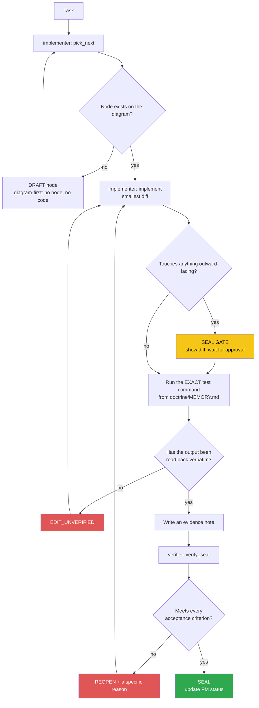

<!-- Diagram: dev-loop -->
<!-- Dev loop: plan - implement - verify - seal -->
DNA: 'smallest_diff / edit_x_read_back_proof_x_independent_verdict'
Auth: 65537 | Version: 1.0.0
Law: LAI-13 - monotonic ratchet (PENDING -> IN_PROGRESS -> SEALED, never demote)

> Every change to the code repo enters here and exits as SEALED or
> REOPENED — no other state in between.

## PM status
> TOKEN DISCIPLINE: this file is read IN FULL every worker session (each
> implementer/verifier subagent loads it fresh). [amended 2026-10-24]
> Archiving is AUTOMATIC: `verify_seal` step 11 moves each row verbatim
> to `dev-loop-archive.md` (same directory) the moment it SEALs, leaves
> a 1-line pointer `| node | SEALED | date — archived, see
> dev-loop-archive.md. Evidence: ... |`, and keeps at most 20 pointers
> here. A row that is not a pointer AND is SEALED here is a backlog from
> before this rule — move it the same way (copy verbatim, DO NOT DELETE,
> DO NOT shorten); normal hub maintenance, no worker loop, no evidence
> note.
>
> `Notes` MUST be a pointer, at most 1 line (e.g. `see
> evidence/implementer/2026-09-02/auth-login-plan.md`), must NOT copy
> evidence content (test logs, diffs, REOPEN reasons...) in here — that
> content already exists verbatim in `evidence/`, copying it here
> duplicates exactly what "one home per fact" (Layer 1) is meant to
> block, just in a different spot. This is the most common real-world
> cause of file bloat observed in practice (see
> the 2026-09-02 usage audit).
>
> Any regression must be a **new node** (LAI-13) — never edit an old
> node's PM status directly to "undo" an existing SEAL. The new-node rule
> is for SEALED nodes only: re-checking or resuming a not-yet-SEALED node
> (PENDING/IN_PROGRESS/BLOCKED_*) updates THAT row in place — a "recheck"
> node per attempt is drift (vuejs hub: 8 open rows for one issue, all
> left behind once a 9th node sealed it). A node that finishes work an
> older open row was tracking lists it under `## Supersedes`;
> `verify_seal` retires that row on SEAL.
>
> The table below is the LAST block of this file: a new row is appended
> at end-of-file (`AppendOnly`), a removed row is deleted with its line —
> no blank lines, no text after the table.

| Node | State | Notes |
|---|---|---|
| `bootstrap-agent-hub` | SEALED | see evidence/verifier/2026-09-20/bootstrap-agent-hub-seal.md |
| `dashboard-reopen-and-quiet` | SEALED | issue #1, see evidence/verifier/2026-09-28/dashboard-reopen-and-quiet-seal.md |
| `dashboard-exclude-indent-guides` | SEALED | see evidence/verifier/2026-09-28/dashboard-exclude-indent-guides-seal.md |
| `claudecode-disable-track-selection` | SEALED | issue #4, see evidence/verifier/2026-10-10/claudecode-disable-track-selection-seal.md |
